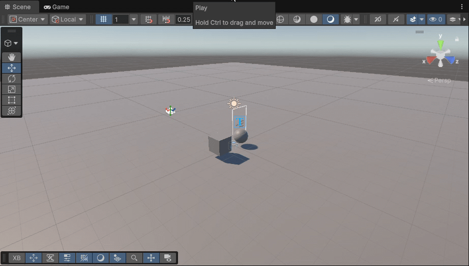

# Practica_6_II
**Asignatura:** Interfaces Inteligentes  
**Universidad:** Universidad de La Laguna (ULL)  
**Autor:** Darío ([@Dario-ULL](https://github.com/Dario-ULL))

---

## Estructura del Repositorio
- **Scripts/**: Contiene los scripts en C# desarrollados para el cambio dinámico de color y la vinculación de eventos con la interfaz de usuario.
- **Gif/**: Contiene las capturas y animaciones GIF que demuestran la interacción por rayo, el agarre directo y la respuesta de la UI.

---

## 1. Descripción del Proyecto
Esta práctica consiste en el desarrollo y configuración de una experiencia inmersiva de Realidad Virtual orientada a dispositivos **Meta Quest** utilizando el **XR Interaction Toolkit (XRI)** y el estándar **OpenXR** sobre el motor **Unity**.

El proyecto implementa la arquitectura base de un rig XR (`XR Origin`) y abarca dos modalidades fundamentales de interacción espacial:
1. **Interacción a distancia (*Ray Interactor*):** Selección y detección remota de objetos geométricos (cubo y esfera) mediante la emisión de rayos, aplicando respuestas visuales dinámicas de cambio de color en base al ciclo de eventos `Select Entered` y `Select Exited`.
2. **Interacción directa (*Direct Interactor*):** Manipulación física y agarre por proximidad de un objeto tridimensional importado de la Asset Store, gobernado por colisiones convexas y dinámicas de `Rigidbody`, el cual notifica en tiempo real su estado de agarre a un panel de interfaz de usuario desacoplado (`Canvas` en *World Space*).

---

## 2. Demostración y Ejecución

### Simulación y Controles en Play Mode

  

---

## 3. Estructura y Componentes Clave

### A. Configuración del Rig y Controladores (`XR Origin`)
Sustitución de la cámara convencional por la jerarquía `XR Origin (XR Rig)` provista por los *Starter Assets*:
- **Punto de Vista (`Main Camera`):** Vinculada al nodo `Camera Offset` para sincronizar la posición y rotación con el visor o la cabeza simulada.
- **Controladores Híbridos (`Near-Far Interactor`):** Integración en mandos izquierdo y derecho para alternar automáticamente entre la detección directa por proximidad (*Direct*) y la proyección de puntero a distancia (*Ray* / `LineVisual`).
- **Simulación en Editor:** Habilitación de `XR Device Simulator` en *Project Settings* con captura de entrada desacoplada (`Ignore Focus` en *Input System*) y atajos de teclado (`WASD`, ratón, teclas `1` y `2`).

### B. Respuesta Dinámica de Color (`ColorChanger.cs`)
Gestión del material y apariencia de los objetos manipulables a distancia:
- **Almacenamiento de Estado:** Cachea la referencia al `Renderer` y la propiedad `material.color` original al inicializarse la escena (`Awake`).
- **Ciclo de Selección:** Al activarse `Select Entered` desde el rayo, el objeto conmuta al color de realce configurado.
- **Restauración Automática:** La suscripción al evento `Select Exited` restablece el color inicial en cuanto el usuario libera el gatillo o desvía la selección.

### C. Agarre Físico Dinámico y Restricciones Colisionables
Configuración física del modelo 3D (*StarGem*) para evitar traspasos de geometría:
- **Malla Convexa (`Mesh Collider - Convex`):** Generación de envolvente cerrada obligatoria para objetos dinámicos calculados por PhysX con gravedad (`Rigidbody.useGravity = true`).
- **Registro de Interactor (`XR Grab Interactable`):** Vinculación explícita del colisionador en el array `Colliders` para asegurar el cálculo de contacto del `Direct Interactor`.

### D. Interfaz de Usuario en Espacio Tridimensional (`UIObjectUpdater.cs`)
Retroalimentación visual en tiempo real de la manipulación de objetos:
- **Canvas World Space:** Lienzo posicionado en el entorno 3D adaptado con tipografía de alto rendimiento (`TextMeshPro`).
- **Notificación por Eventos:** Métodos públicos `OnGrabbed()` y `OnReleased()` enlazados a los hooks de interacción del objeto para alternar cadenas de texto informativas (*"¡Objeto agarrado!"* / *"Objeto soltado"*).
